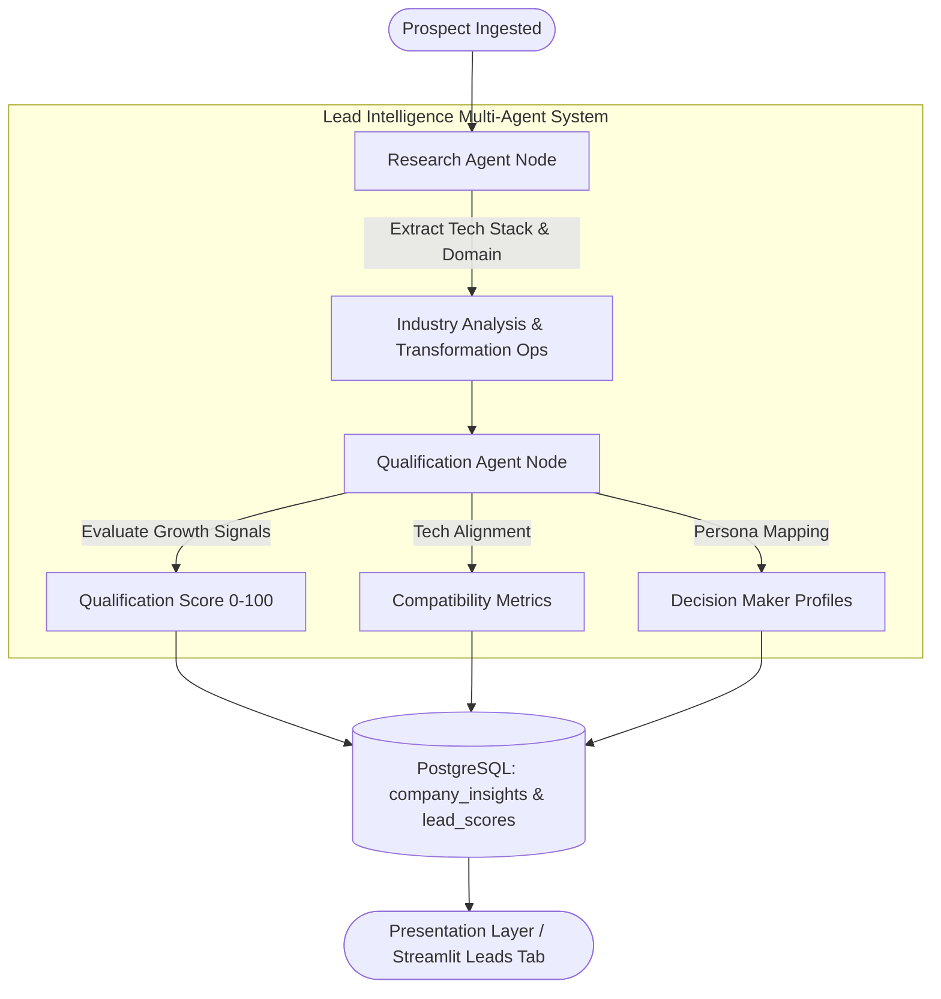

# LangGraph Agent Architecture: Lead Intelligence Engine (Module 2)

## 1. Overview
The **Lead Intelligence Engine** is built using **LangGraph** to perform automated multi-agent analysis on newly ingested prospect profiles. It operates as an asynchronous, stateful DAG (Directed Acyclic Graph) workflow implementing IEEE Std 830-1998 requirements:
- **REQ-M2-01**: Automated Company Profiling & Tech Stack Categorization
- **REQ-M2-02**: Business Opportunity Identification (ERP Modernization, Cloud Migration, Process Automation, Digital Transformation)
- **REQ-M2-03**: Qualitative Intelligence Summary, Qualification Scoring (0-100), and Buying Committee Personas

---

## 2. Multi-Agent Architecture Topology

---

## 3. Agent Node Roles & Responsibilities

| Agent Node | Responsibility | Grounding / Source | Output Fields |
| :--- | :--- | :--- | :--- |
| **Research Agent** | Parses domain, active tech stack components (Cloud, Backend, Frontend, Data/DB, DevOps), extracts growth indicators, and detects business transformation opportunities. | Ingested prospect record + LLM / Rule-based engine | `industry_domain_analysis`, `growth_indicators`, `tech_stack_components`, `transformation_opportunities` |
| **Qualification Agent** | Evaluates funding stage signals, revenue budget capacity, computes Qualification Score (0-100), profiles buying committee decision makers, and compiles strategic recommendation. | Intermediate state from Research Agent | `qualification_score`, `high_growth_potential`, `tech_alignment_metrics`, `decision_makers`, `business_needs_summary`, `strategic_recommendation` |

---

## 4. State Persistence & PostgreSQL Integration

Generated intelligence outputs are persisted directly to the platform's PostgreSQL database:
* **`company_insights`**: Stores `industry_analysis`, `opportunities` (JSON), `growth_indicators` (JSON), `tech_alignment` (JSON), `decision_maker_summary` (JSON), and `qualification_score`.
* **`lead_scores`**: Stores `lead_score` (0-100) and `conversion_probability` (Decimal).
* **`leads`**: Automatic lifecycle promotion (`lead_status = 'Qualified'`) when `qualification_score >= 70`.

---

## 5. Performance SLA Target
In compliance with IEEE 830 Clause 5.3.6:
* End-to-end multi-agent execution completes in **< 5.0 seconds** per prospect record.
