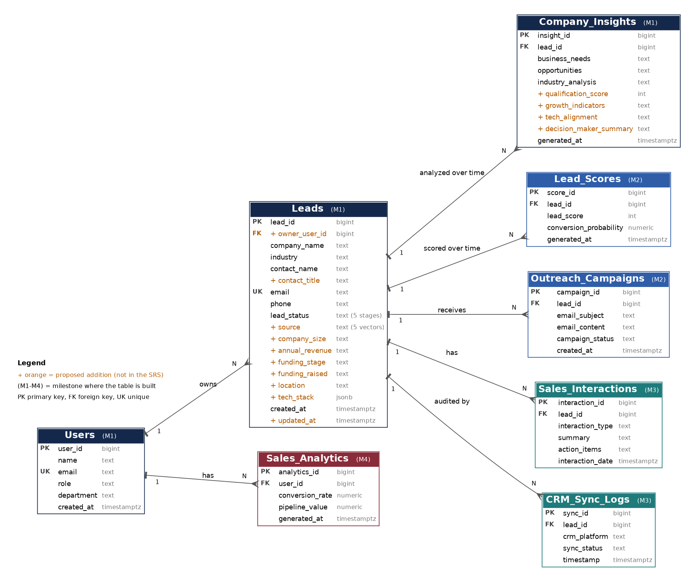
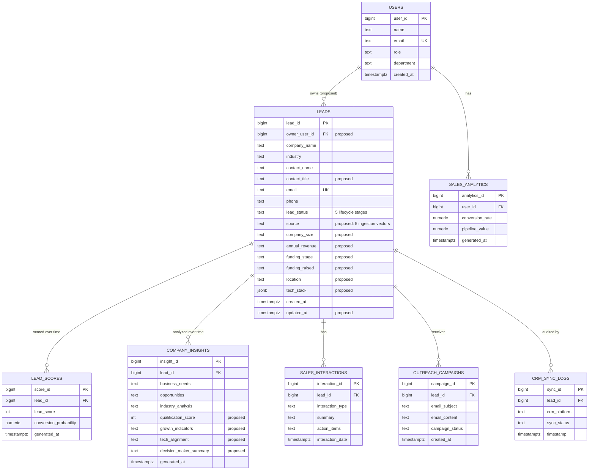

# ER Diagram

GitHub renders the diagram below directly. A styled export is in `er-diagram.png` / `er-diagram.svg` (source: `er-diagram.dot`, rebuild with `dot -Tpng er-diagram.dot -o er-diagram.png`).

Fields marked `"proposed"` are additions that are **not in the SRS**; see [README.md](README.md) for why each is proposed and which need team sign-off.

